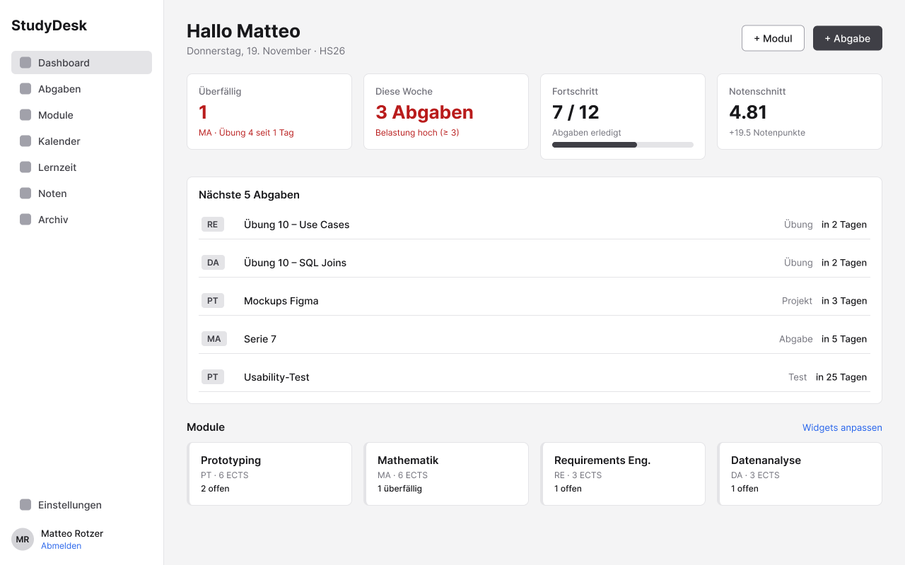
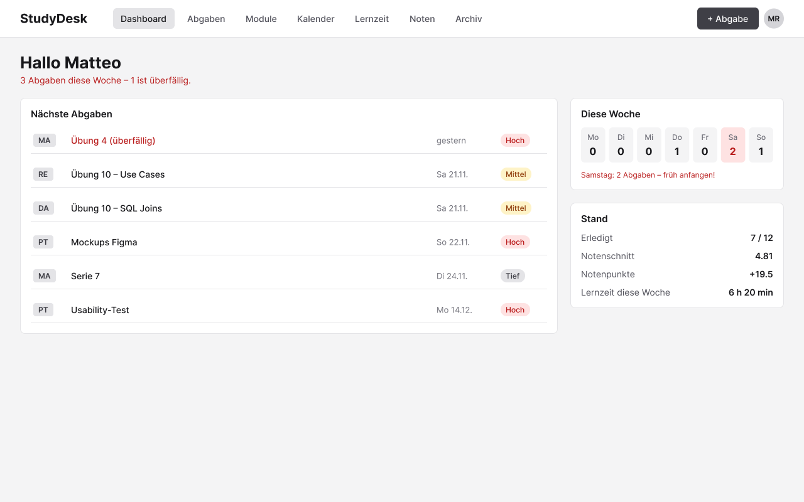
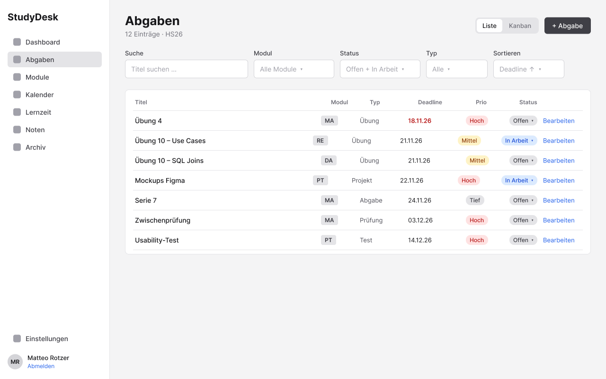
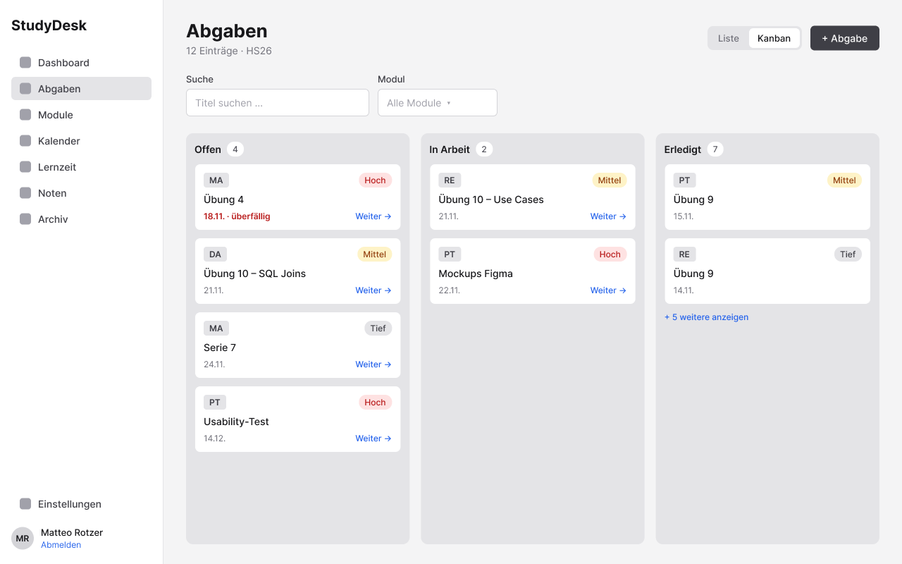
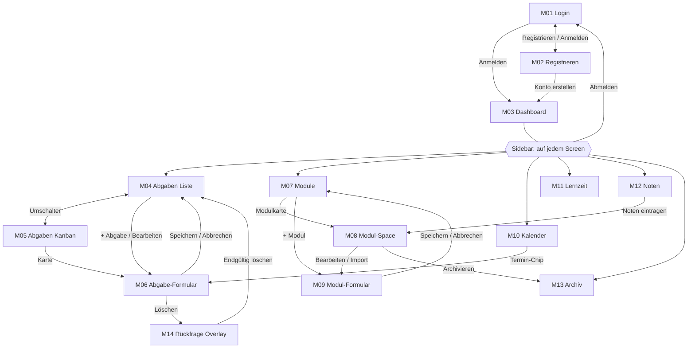
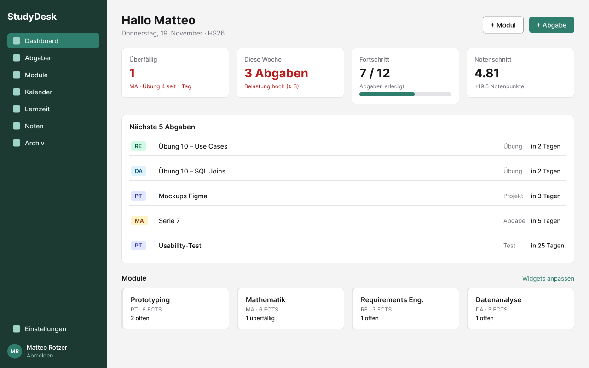
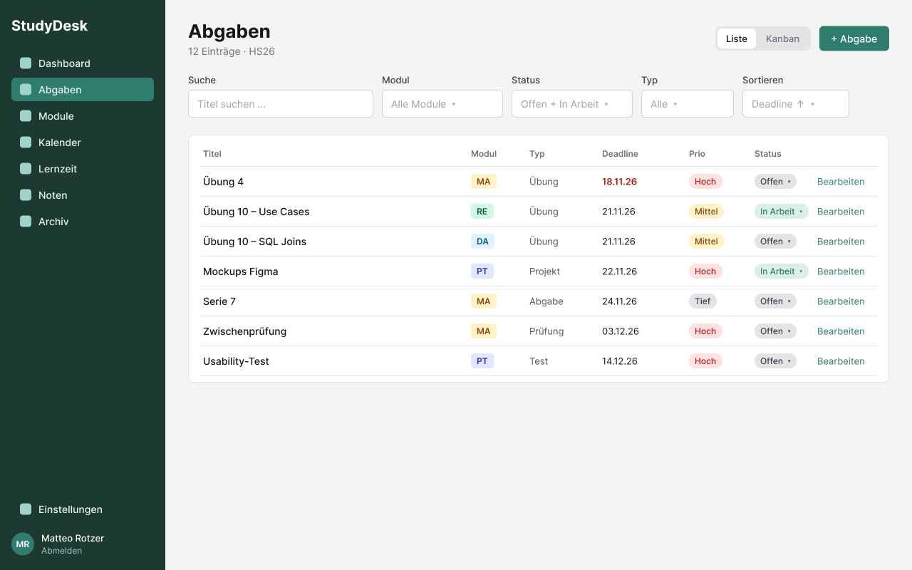
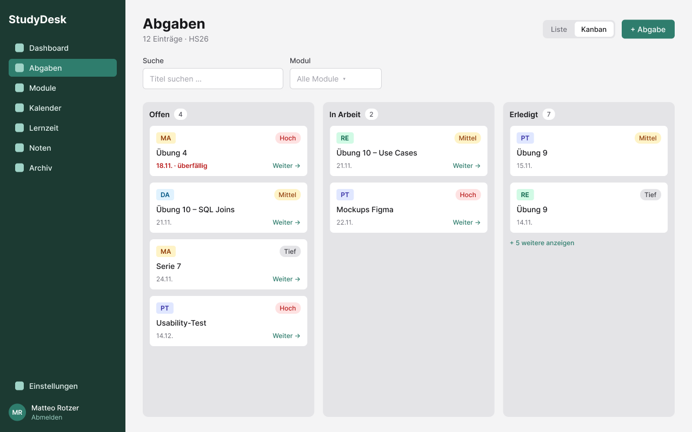
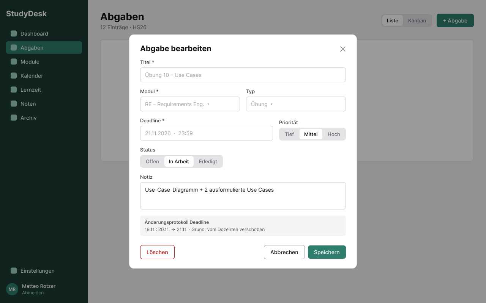

# Projektdokumentation - StudyDesk

## Projektübersicht & Zugänge

| Angabe | Inhalt |
|---|---|
| Projekttitel | StudyDesk |
| Verfasser/in | Matteo Rotzer, _[Klasse folgt]_ |
| GitHub-Repository | https://github.com/mat058/study-desk |
| Aktuelle App | https://study-desk-mr.netlify.app |
| Getestete Version | _[Link; Commit/Tag]_ |
| Testzugänge | _[Testkonten je Rolle oder Bereitstellungsweg; andernfalls «Nicht erforderlich»]_ |
| Figma / Referenz-Mockup | Klickbarer Prototyp: https://www.figma.com/proto/XofFCUkretdp9KRkDgiZRn/StudyDesk?page-id=1%3A3&node-id=11-332&starting-point-node-id=11%3A332&scaling=scale-down · Design-Datei: https://www.figma.com/design/XofFCUkretdp9KRkDgiZRn (Seite «2 Mockup»; Seite «1 Wireframes (verbessert)» = Vorstufe) |
| Weitere Artefakte [Optional] | Projektboard: https://github.com/users/mat058/projects/2 |

> **Zugriff:** Stellt sicher, dass alle Dozierenden auf das Repository, die App und die verlinkten Artefakte zugreifen können.

> **Testzugänge:** Verwendet eigens eingerichtete Testkonten mit unkritischen Daten. Bei einem öffentlichen Repository gebt ihr hier nur den vereinbarten Bereitstellungsweg an. Persönliche Passwörter, API-Schlüssel und andere Geheimnisse dürfen nicht im Repository stehen.

<!-- Zentrale Projektlinks ausschliesslich in der Projektübersicht pflegen. Spezifische Nachweise wie Codestellen oder Testprotokolle direkt im jeweiligen Fachkapitel verlinken. -->

## Inhaltsverzeichnis

[Projektübersicht & Zugänge](#projektübersicht--zugänge)

1. [Ausgangslage](#1-ausgangslage)
2. [Lösungsidee](#2-lösungsidee)
3. [Vorgehen & Artefakte](#3-vorgehen--artefakte)
    1. [Understand & Define](#31-understand--define)
    2. [Sketch](#32-sketch)
    3. [Decide](#33-decide)
    4. [Prototype](#34-prototype)
    5. [Validate](#35-validate)
4. [Erweiterungen [Optional]](#4-erweiterungen-optional)
5. [Projektorganisation [Optional]](#5-projektorganisation-optional)
6. [KI-Deklaration](#6-ki-deklaration)
7. [Anhang [Optional]](#7-anhang-optional)

> **Hinweis:** Massgeblich sind die im **Unterricht** und auf **Moodle** kommunizierten Anforderungen.

<!-- Diese Vorlage ist für eine README.md im Repository gedacht. -->

<!-- WICHTIG: Reihenfolge, Nummerierung und Benennung der vorgegebenen Kapitel beibehalten. Als [Optional] gekennzeichnete Abschnitte dürfen entfallen, sofern in den Übungen nichts anderes verlangt wird. Ohne KI-Einsatz dürfen zudem die Unterkapitel 6.1–6.3 entfallen; die ausdrückliche Angabe dazu in Kap. 6 bleibt verpflichtend. Die in Kap. 4 vorgesehenen Einträge für einzelne Erweiterungen sind entsprechend zu ergänzen. -->

## 1. Ausgangslage
Kurz beschreiben, welches Problem adressiert wird und welches Ergebnis angestrebt ist. Wem nützt die Lösung, wer ist beteiligt oder betroffen?
- **Problem:** Studierende erhalten Termine, Abgaben und Leistungsnachweise über viele Kanäle (Moodle, Semesterprogramm-PDFs, E-Mail, Teams). Es gibt keinen vollständigen, verlässlichen Überblick: Die Moodle-Deadline-Ansicht ist unvollständig, Angaben widersprechen sich teilweise zwischen den Kanälen, und mangels Schnittstellen muss alles manuell in eigene Tools (z. B. Apple Erinnerungen, Notion) übertragen und nachgeführt werden. *Beispiel:* Für dieselbe Abgabe stehen in Moodle, im Semesterprogramm und in einer Mail unterschiedliche Daten – man muss jedes Mal nachfragen, welches gilt. Allein das Erfassen zu Semesterbeginn dauert rund eine Woche.
- **Ziele:**
  - Alle Module, Abgaben und Leistungsnachweise eines Semesters an **einem** Ort
  - Auf einen Blick sehen, was als Nächstes fällig ist und welche Wochen intensiv werden
  - Widersprüchliche oder geänderte Termine erkennen statt übersehen
  - Weniger Aufwand fürs Erfassen und Nachführen
- **Primäre Zielgruppe:** Bachelor-Studierende der ZHAW (insbesondere Vollzeitstudierende mit vielen Modulen und Studierende mit Nebenjob), die ihr Semester selbst organisieren.
- **Weitere Stakeholder [Optional]:** Dozierende (pflegen Moodle und Semesterprogramme; Quelle der Termine), Mitstudierende (Austausch über gültige Termine).

Details: [Übung 8 – Understand & Define (PDF)](docs/01-understand/Uebung8_Understand-Define_StudyDesk_Rotzer.pdf)

## 2. Lösungsidee
Beschreibt die Lösungsidee.
StudyDesk ist ein persönlicher Semester-Hub: Module, Leistungsnachweise und Deadlines werden an **einem** Ort erfasst, und das Dashboard zeigt sofort, was als Nächstes dran ist.

- **Kernfunktionalität:** (Details: [Requirements – Epics, User Stories, MoSCoW](docs/01-understand/2026-11-12_requirements.md))
  - *Konto:* Registrieren, an- und abmelden; jede Person sieht nur ihre eigenen Daten.
  - *Module verwalten:* Modul erfassen, bearbeiten, löschen (Name, Kürzel, Semester, ECTS, Dozierende, Farbe); pro Modul ein **Modul-Space** mit allen Infos und Abgaben.
  - *Abgaben verwalten:* Abgabe/Prüfung/Übung mit Modul, Typ, Deadline und Priorität erfassen, bearbeiten, löschen; Status mit einem Klick ändern (offen → in Arbeit → erledigt).
  - *Überblick:* Dashboard mit den nächsten fälligen Abgaben und Schnellbuttons «+ Abgabe» / «+ Modul».
  - *Geplante Ergänzungen (Should/Could):* Filter, Notizen, Fortschritt, Kalenderansicht, Semester-Archiv, PDF-Import von Semesterprogramm und Modulbeschreibung, Noten & Notenpunkte, Lernzeit.
- **Annahmen [Optional]:** (werden im Usability-Test geprüft)
  - Eine Abgabe lässt sich in **unter 30 Sekunden** erfassen – schnell genug, dass Studierende die App wirklich nachführen.
  - Das Dashboard beantwortet die Frage «Was ist jetzt dran?» ohne weiteres Klicken.
  - Ein Modul-Space pro Modul wird als übersichtlicher empfunden als die Suche in den einzelnen Moodle-Kursen.
- **Abgrenzung [Optional]:** Keine direkte Anbindung an Moodle oder andere Hochschulsysteme (keine offene Schnittstelle), keine KI-Erkennung von PDFs (falls Import, dann reine Code-Erkennung), keine Gruppen-/Teilen-Funktionen, keine Push- oder Mail-Benachrichtigungen, keine native Mobile-App (Web-App, responsive).

## 3. Vorgehen & Artefakte
Die Durchführung erfolgt phasenbasiert; dokumentiert die wichtigsten Ergebnisse je Phase.

### 3.1 Understand & Define
- **Zielgruppenverständnis:**
  - *Problemräume:* vier Problemräume gesammelt (fehlender zentraler Überblick, fehlende Schnittstellen, zu viele Apps für den gleichen Zweck, Faszination KI); gewählt wurde «Studium organisieren», weil selbst täglich betroffen und die Zielgruppe für Tests direkt erreichbar ist.
  - *Problemraum-Analyse:* Nutzergruppen (Vollzeit, Vollzeit mit Nebenjob, Teilzeit, Erstsemestrige), heutige Tools mit Schwächen, typischer Ablauf bei einer neuen Abgabe, Bedürfnisse.
  - *How Might We:* (1) Wie könnten wir Studierenden helfen, alle Abgaben und Leistungsnachweise eines Semesters an einem Ort zuverlässig im Blick zu behalten? (2) Wie könnten wir das Erfassen und Nachführen von Terminen so vereinfachen, dass keine Änderung verloren geht und klar ist, welches Datum gilt? (3) Wie könnten wir Studierenden mit Nebenjob helfen, früh zu erkennen, welche Wochen intensiv werden?
  - *Recherche:* Moodle, Apple Erinnerungen/Kalender, Notion-Vorlagen, Studienplaner-Apps (z. B. MyStudyLife), To-do-Apps.
  - *(Proto-)Personas:* [Julian](docs/01-understand/2026-11-10_personas.md#persona-1--julian-der-effiziente-mit-nebenjob) – Vollzeit mit Nebenjob, knappe Zeit, will eine verlässliche Quelle und die Wochen-Auslastung sehen · [Leonie](docs/01-understand/2026-11-10_personas.md#persona-2--leonie-die-erstsemestrige-im-kanal-dschungel) – Erstsemestrige ohne Job, überflutet von Kanälen, braucht sofort «Was ist jetzt dran?».
  - *Requirements (zusätzliche Methode aus Requirements Engineering):* 7 Epics, 35 User Stories mit Akzeptanzkriterien, MoSCoW-Priorisierung und Datenmodell-Entwurf → [Requirements](docs/01-understand/2026-11-12_requirements.md). Die Must- und Should-Stories sind als Issues im [Projektboard](https://github.com/users/mat058/projects/2) erfasst (#16–#34).
  - Vollständige Ausarbeitung: [Antworten Übung 8](docs/01-understand/2026-11-10_antworten-uebung8.md) · [PDF](docs/01-understand/Uebung8_Understand-Define_StudyDesk_Rotzer.pdf)
- **Wesentliche Erkenntnisse:**
  - Es gibt viele Tools, aber jedes deckt nur einen Teil ab – der Überblick entsteht erst im Kopf der Studierenden.
  - Der grösste Aufwand liegt im **Erfassen und Nachführen**, nicht im Anschauen.
  - **Verlässlichkeit** (welches Datum gilt?) ist mindestens so wichtig wie Vollständigkeit.
  - Ohne offene Schnittstellen der Hochschulsysteme muss die Lösung manuelles Erfassen so schnell wie möglich machen und Mehrwert *auf* den erfassten Daten bieten (z. B. Widersprüche, Belastung).

### 3.2 Sketch
- **Variantenüberblick:** Navigation A (Sidebar) vs. B (Topbar) und Abgaben als Liste vs. Kanban; dazu 10 weitere Screens (Login, Registrieren, Abgabe-Formular, Module, Modul-Space, Modul-Formular, Kalender, Lernzeit, Noten, Archiv).
- **Erste Ideen (Crazy 8s, Übung 9):** In der Kleinklasse entstanden acht schnelle Ideenskizzen (Crazy 8s) mit Peer-Voting und eine ausgearbeitete Skizze (Overview + Deadlines-Tabelle). Sie dienten als erster Ideenspeicher; die massgeblichen Varianten für StudyDesk wurden danach separat ausgearbeitet (siehe unten). → [Crazy 8s](docs/02-sketch/uebung9-kleinklasse/2026-11-12_uebung9_crazy8s-kleinklasse.jpg) · [Ausgearbeitete Skizze](docs/02-sketch/uebung9-kleinklasse/2026-11-12_uebung9_skizze-ausgearbeitet-kleinklasse.jpg)
- **Skizzen (iPad, Original):** 11 Seiten von Hand – Login, Navigation/Dashboard, Abgabenliste, Abgaben als Kanban (v2), Modul-Space, Modulliste, Formulare Abgabe und Modul, Kalender, Archiv → [PDF](docs/02-sketch/original/2026-11-19_ipad-skizzen-original.pdf)
- **Skizzen (verbessert, Wireframes):** in Figma als Graustufen-Wireframes nachgebaut und verbessert (14 Screens, inkl. neu Registrieren, Lernzeit, Noten und Navigations-Variante B). Jede Änderung ist im Figma unter dem Screen begründet; Übersicht und Liste der Änderungen: [docs/02-sketch/ai-improved/README.md](docs/02-sketch/ai-improved/README.md)
- **Varianten im Vergleich:**

  | Navigation A – Sidebar | Navigation B – Topbar |
  |---|---|
  |  |  |
  | **Abgaben – Liste** | **Abgaben – Kanban** |
  |  |  |

  Alle 14 Wireframes als PNG: [docs/02-sketch/ai-improved/](docs/02-sketch/ai-improved/README.md)
- **Wichtigste Verbesserungen:** fehlende Screens ergänzt (Registrieren, Lernzeit, Noten), einheitliche Aktionen oben rechts, Formulare mit Pflichtfeldern und sichtbarem Fehler-/Erfolgsfeedback, Import ins Modul verschoben, Kalender-Sync realistisch auf .ics-Abo reduziert, Kanban-Statuswechsel per Button statt Drag & Drop.

### 3.3 Decide
- **Gewählte Variante & Begründung:** Navigation **A (Sidebar)** und Abgaben als **Liste + Kanban mit Umschalter**. Kriterien: Platz für 7 Hauptbereiche, Erweiterbarkeit, Orientierung (aktiver Bereich sichtbar), Nutzen für beide Personas, Aufwand. Die Topbar (B) gibt mehr Breite, wird aber mit Menü und Schnellaktionen eng. Liste und Kanban zeigen dieselben Daten: Liste zum Filtern und Sortieren, Kanban für den Stand auf einen Blick. Vereinfachungen: .ics-Abo statt Kalender-Sync, Statuswechsel per Button statt Drag & Drop, Import im Modul. Desktop-first (1280 px). → Entscheide D16–D20 in [docs/decisions.md](docs/decisions.md), alle 12 Designentscheide in der [Abgabe Übung 10](docs/03-decide/uebung10_abgabe.md)
- **End-to-End-Ablauf:** Login → Dashboard («Was ist als Nächstes fällig?») → «+ Abgabe» → Formular speichern → Abgabe erscheint in Liste/Kanban → Status ändern bis «Erledigt» → Fortschritt im Dashboard steigt. Module werden in «Module» angelegt und im Modul-Space gepflegt (Abgaben, Notizen, Noten), am Semesterende archiviert. User Journey Map (SOLL, Persona Leonie): [Abgabe Übung 9, Kap. 6](docs/02-sketch/uebung9-kleinklasse/uebung9_abgabe.md). Workflows als Flowcharts:

  

  Einzelne Workflows: [Login](docs/03-decide/workflows/wf-1-login.png) · [Abgabe erfassen/bearbeiten/löschen](docs/03-decide/workflows/wf-2-abgabe.png) · [Status ändern](docs/03-decide/workflows/wf-3-status.png) · [Modul anlegen bis archivieren](docs/03-decide/workflows/wf-4-modul.png)
- **Mockup:** klickbar in Figma, 14 Screens + 4 Overlays (Löschen bestätigen, Noten einstellen mit Wunschnote, Widgets anpassen, Kalender abonnieren), Start bei «M01 Login» (Link in der [Projektübersicht](#projektübersicht--zugänge)). Abgabe Übung 10 mit Designentscheiden und durchgespielten Workflows: [PDF](docs/03-decide/Uebung10_UI-Prototyping_StudyDesk_Rotzer.pdf).

  | Dashboard (M03) | Abgaben – Liste (M04) |
  |---|---|
  |  |  |
  | **Abgaben – Kanban (M05)** | **Abgabe-Formular (M06)** |
  |  |  |

  Dashboard beantwortet die Kernfrage nach dem Login; die Abgaben lassen sich oben rechts zwischen Liste und Kanban umschalten; das Formular liegt als Modal über der Liste und ist für Erfassen und Bearbeiten dasselbe. Alle Screens: [docs/03-decide/mockup/](docs/03-decide/mockup/)

### 3.4 Prototype

#### 3.4.1. Entwurf (Design)
Beschreibt die Gestaltung und Interaktion.
> **Hinweis:** Hier wird der **Prototyp** beschrieben, nicht das **Mockup**.
- **Informationsarchitektur:** _[z. B. Seiten/Navigation: Konzept, nicht die technische Umsetzung]_
- **User Interface Design:** _[wichtige Screens: Screenshots mit kurzen Erläuterungen]_  
- **Designentscheidungen:** _[zentrale Entscheidungen und Begründungen]_

#### 3.4.2. Umsetzung (Technik)
Fasst die technische Realisierung zusammen.
- **Technologie-Stack:** SvelteKit 3 (verbindliche Vorgabe). _[Verwendete Bibliotheken ergänzen, falls genutzt.]_
- **Tooling:** Visual Studio Code, Git & GitHub (Repository, Issues, Project Board), MongoDB Atlas (Datenbank, Gratis-Cluster M0), Netlify (Deployment, automatisch bei Push auf `main`), Figma (Mockup). Den Einsatz von KI beschreibt Kapitel **KI-Deklaration**.  
- **Vorgehen bei der Implementierung:** _[Wie wurde die Umsetzung schrittweise erarbeitet? Wie wurden Funktionen entwickelt, geprüft und überarbeitet? Bei KI-Unterstützung: Zusammenspiel zwischen eigener Arbeit und KI kurz beschreiben und für Details auf Kap. 6 verweisen.]_
- **Struktur & Komponenten:** _[Seiten, Routen, State/Stores, wichtige Komponenten]_
- **Daten & Schnittstellen:** _[Wie werden Daten gespeichert, verwaltet, abgerufen?]_
- **Deployment:** Link siehe «Aktuelle App» in der [Projektübersicht](#projektübersicht--zugänge).
- **Besondere Entscheidungen:** _[z. B. Trade-offs, Vereinfachungen]_  

### 3.5 Validate

> **Hinweis:** Die Evaluation muss nachvollziehbar dokumentiert sein. Belegt die beschriebenen Beobachtungen und Resultate durch geeignete Nachweise und verlinkt diese im Feld «Nachweise». Die Materialien können im Repository abgelegt oder im Anhang aufgeführt werden. Personenbezogene Angaben sind zu anonymisieren.

- **Getestete Version:** Separat deployt; Link und Commit/Tag siehe «Getestete Version» in der [Projektübersicht](#projektübersicht--zugänge).
- **Ziele der Prüfung:** _[welche Fragen sollen beantwortet werden?]_  
- **Vorgehen:** _[moderiert/unmoderiert; remote/on-site]_  
- **Stichprobe:** _[Mit wem wurde getestet? Profil; Anzahl]_  
- **Aufgaben/Szenarien:** _[Ausformulierte Testaufgaben]_  
- **Kennzahlen & Beobachtungen:** _[z. B. Erfolgsquote, Zeitbedarf, qualitative Findings]_  
- **Nachweise:** _[Verweise auf anonymisierte Testprotokolle, Beobachtungsnotizen, Auswertungstabellen oder andere geeignete Belege für die beschriebenen Beobachtungen und Resultate]_
- **Zusammenfassung der Resultate:** _[Wichtigste Erkenntnisse; 2-4 Sätze]_  
- **Abgeleitete Verbesserungen:** _[Anforderungen, die als nächstes umgesetzt werden sollten, priorisiert, kurz begründet. Umgesetzte Verbesserungen hier kurz beschreiben. Gehen sie über den Mindestumfang hinaus, zusätzlich nach dem Schema in Kap. 4 dokumentieren.]_

## 4. Erweiterungen [Optional]
Dokumentiert hier Erweiterungen über den Mindestumfang hinaus. Ordnet jede Erweiterung einem der beiden Unterkapitel zu und beschreibt sie einzeln.

> **Hinweis zur Bewertung:** Nur dokumentierte Erweiterungen werden bewertet. Für nicht dokumentierte Erweiterungen oder Erweiterungen, deren Beschreibung bzw. Nachweise die folgenden Vorgaben nicht erfüllen, werden keine Punkte vergeben.

> **Verbindliche Struktur:** Jede Erweiterung muss vollständig und exakt nach dem Schema des jeweiligen Unterkapitels beschrieben werden. Alle Felder sind mit unveränderten Bezeichnungen und in der vorgegebenen Reihenfolge auszufüllen. Wiederholt das Schema für jede weitere Erweiterung und nummeriert die Einträge fortlaufend (4.1.2, 4.1.3 bzw. 4.2.2, 4.2.3). Zusätzliche Erläuterungen innerhalb der Felder sind möglich.

> **Erforderliche Nachweise:** Fügt zu jeder Erweiterung nach Möglichkeit mindestens einen aussagekräftigen Screenshot mit kurzer Erläuterung ein. Falls ein Screenshot nicht sinnvoll möglich ist, begründet dies kurz im Feld «Nachweise» und gebt einen anderen geeigneten Nachweis an. Bei Erweiterungen mit Code sind zusätzlich die relevanten Codestellen zu referenzieren, beispielsweise durch Links auf Dateien und die betreffenden Funktionen oder Zeilenbereiche.

### 4.1 Software-Erweiterungen
Hierzu gehören zusätzliche Funktionen und technische Verbesserungen am Prototyp.

#### 4.1.1 [Titel der Erweiterung]
- **Beschreibung & Nutzen:** _[Was wurde erweitert und welchen Mehrwert bietet es?]_
- **Abgrenzung zum Mindestumfang:** _[Was geht konkret über die verbindlichen Anforderungen hinaus?]_
- **Umsetzung:** _[Wie und wo wurde die Erweiterung umgesetzt?]_
- **Nachweise:** _[Screenshot(s) mit Erläuterung; Referenzen auf die relevanten Codestellen; gegebenenfalls weitere Belege]_
- **Bezug zur Evaluation:** _[Wurde die Erweiterung aus der Evaluation abgeleitet? Falls ja: auf die betreffende Beobachtung bzw. das Issue verweisen. Andernfalls: «Nein».]_

### 4.2 Weitere Erweiterungen
Hierzu gehören beispielsweise zusätzliche Methoden, Planungs- und Analyseartefakte, Verbesserungen der Projektorganisation oder Anpassungen eines KI-Agenten-Workflows.

#### 4.2.1 Requirements Engineering: Epics, User Stories, MoSCoW
- **Beschreibung & Nutzen:** Aus Personas und Problemanalyse wurden 7 Epics und 35 User Stories mit prüfbaren Akzeptanzkriterien abgeleitet, nach MoSCoW priorisiert und daraus ein Datenmodell-Entwurf erstellt. Nutzen: klarer, begründeter Umfang (was ist Mindestumfang, was Erweiterung), direkt testbare Kriterien für den Usability-Test und eine Grundlage für das Issue-Management.
- **Abgrenzung zum Mindestumfang:** Der Unterricht verlangt Problemverständnis, Personas und Ideenfindung; User Stories mit Akzeptanzkriterien, MoSCoW-Priorisierung und Datenmodell stammen aus dem Modul Requirements Engineering und gehen darüber hinaus.
- **Umsetzung:** Epics im Frage-Antwort-Verfahren erarbeitet (Entscheide in Abschnitt 1.1 der Requirements), Machbarkeit des PDF-Imports anhand echter ZHAW-Semesterprogramme geprüft, Stories mit Personas verknüpft, Must- und Should-Stories als GitHub-Issues (#16–#34) mit Akzeptanzkriterien als Checklisten angelegt.
- **Nachweise:** [Requirements-Dokument](docs/01-understand/2026-11-12_requirements.md) · Issues #16–#34 im [Projektboard](https://github.com/users/mat058/projects/2) · Screenshot [Board mit Feature-Issues](docs/organisation/2026-11-18_board-status-spalten.png): Die aus den Epics abgeleiteten Issues liegen nach Priorität in «Ideen» (Could, z. B. #40–#45) und «Backlog» (Must/Should), die RE-Arbeit selbst (#6) ist erledigt.
- **Bezug zur Evaluation:** Nein (vorgelagert). Die Akzeptanzkriterien und Annahmen (z. B. «Abgabe erfassen < 30 Sekunden») dienen als Grundlage für die Testaufgaben in Kap. 3.5.

#### 4.2.2 KI-Agenten-Workflow (Claude) mit versionierter Konfiguration
- **Beschreibung & Nutzen:** Für das Projekt wurde ein eigener, im Repository versionierter Arbeitsablauf mit dem KI-Agenten Claude aufgebaut: Projektkontext und Regeln in [CLAUDE.md](CLAUDE.md), eigene Slash-Commands in [.claude/commands/](.claude/commands/), Modell-Einstellung `opusplan` in [.claude/settings.json](.claude/settings.json), Prompt-Rezepte in [docs/prompts/](docs/prompts/), feste Aufgabenteilung zwischen Claude-Chat und Claude Code sowie ein lückenloses [KI-Log](docs/ai-log.md). Nutzen: Der Agent kennt Ziel, Stack und Konventionen in jeder Session, führt die Dokumentation nach jedem Schritt selbst nach, hält Grenzen ein (keine Secrets, kein Push/Deploy ohne Freigabe) und der KI-Einsatz bleibt jederzeit nachvollziehbar.
- **Abgrenzung zum Mindestumfang:** Verlangt sind der Einsatz von KI und dessen Deklaration (Kap. 6). Darüber hinaus gehen die projektspezifische Agenten-Konfiguration (Kontextdatei, Commands, Modell-Routing Opus/Sonnet, definierte Kontextquellen) und die versionierten Prompt-Rezepte; die Aufgabenstellung nennt die «Anpassung eines KI-Agenten-Workflows» ausdrücklich als Erweiterung.
- **Umsetzung:**
  - *Kontext & Regeln:* `CLAUDE.md` enthält Projektziel, Pflicht-Anforderungen, Code-Konventionen (DB-Zugriff nur in `db.js`, Form Actions, Runes), Git-Regeln, Doku-Regeln mit festem Antwortformat («⚡ JETZT WICHTIG»: Screenshot, README-Kapitel, KI-Log, Entscheid, Commit, Verbesserung, Fehlendes) und Grenzen für den Agenten.
  - *Commands:* `/doku-check` (Stand gegen Bewertungsraster prüfen, priorisiert 🔴/🟡/🟢), `/erweiterung` (Erweiterung exakt nach Schema Kap. 4 dokumentieren), `/session-end` (Session zusammenfassen, KI-Log, Screenshots, Entscheide, Commit-Nachricht), `/security-check` (Sicherheitsprüfung nach Checkliste für SvelteKit + MongoDB: Secrets, Passwort-Hashing, Session-Cookies, Zugriff nur auf eigene Daten, Eingabevalidierung/NoSQL-Injection, XSS, CSRF, Abhängigkeiten – nur berichten, nichts ändern).
  - *Modellwahl:* Claude Code mit `opusplan`: im Plan-Modus Opus (Analyse, Architektur, Plan), bei der Umsetzung Sonnet (Code nach freigegebenem Plan); Ausnahmen für schwierige Bugs (Opus) und Security-Check (Plan-Modus) – Begründung in [decisions.md](docs/decisions.md) D21 und Kap. 6.1.
  - *Aufgabenteilung:* Chat = planen, entscheiden, Phasen Understand bis Decide, Figma, Übungsabgaben; Claude Code = Implementierung pro Issue auf `feat/`-Branch mit Pull Request; Übergabe über GitHub-Issues und Repo-Doku.
  - *Kontextquellen:* Kursunterlagen (Folien, Bewertungsraster, README-Vorlage), Repo, Projektboard; Anbindungen über MCP (Figma, Notion) und `gh` CLI.
- **Nachweise:** [CLAUDE.md](CLAUDE.md) · [.claude/commands/doku-check.md](.claude/commands/doku-check.md), [erweiterung.md](.claude/commands/erweiterung.md), [session-end.md](.claude/commands/session-end.md), [security-check.md](.claude/commands/security-check.md) · [.claude/settings.json](.claude/settings.json) · [docs/prompts/](docs/prompts/) · [KI-Log](docs/ai-log.md) (jede Session mit Tool/Modell, Aufgabe, eigener Prüfung) · _[Screenshot folgt: Ausgabe von `/doku-check` in Claude Code → `docs/extensions/JJJJ-MM-TT_agent-doku-check.png`; Modellwahl `/model` mit «opusplan» → `docs/extensions/JJJJ-MM-TT_agent-opusplan.png`; Ausgabe von `/security-check` nach Login → `docs/extensions/JJJJ-MM-TT_security-check.png`]_
- **Bezug zur Evaluation:** Nein.

#### 4.2.3 Projektorganisation: Issue-Management, Board und Commit-Praxis
- **Beschreibung & Nutzen:** Das Projekt wird vollständig über GitHub organisiert: ein Issue pro Arbeitspaket bzw. User Story mit Akzeptanzkriterien als Checkliste (Issue-Vorlage), Meilensteine je Phase, Labels, Kanban-Board mit fünf Status-Spalten, Conventional Commits auf Deutsch mit Issue-Referenz, Feature-Branches mit Pull Request und eine nach Phasen geordnete Ablage aller Artefakte. Nutzen: Der Projektstand ist jederzeit sichtbar, jede Änderung ist einem Issue zugeordnet und die Historie bleibt nachvollziehbar (Details in [Kap. 5](#5-projektorganisation-optional)).
- **Abgrenzung zum Mindestumfang:** Verlangt ist ein GitHub-Repository mit Code und Dokumentation. Darüber hinaus gehen das systematische Issue-Management (Vorlage, Akzeptanzkriterien, Labels, Meilensteine), das Board mit Status-Workflow, die verbindliche Commit-Konvention mit Issue-Bezug und das Branch-/PR-Vorgehen.
- **Umsetzung:** Setup-Skript für Labels, Meilensteine und Issues ([scripts/](scripts/)); Issue-Vorlage [.github/ISSUE_TEMPLATE/feature.md](.github/ISSUE_TEMPLATE/feature.md) mit Doku-Checkliste (Screenshot, README, KI-Log); Board-Spalten 💡 Ideen · 📋 Backlog · 🎯 Als Nächstes · In Arbeit · Erledigt; Commit-Regel und Branch-Vorgehen in [CLAUDE.md](CLAUDE.md); Entscheide zentral in [decisions.md](docs/decisions.md); Artefakte in `docs/01-understand` bis `docs/05-validate`.
- **Nachweise:** [Board mit Status-Spalten](docs/organisation/2026-11-18_board-status-spalten.png) (Issues nach Priorität und Stand verteilt) · [Issue-Liste](docs/organisation/2026-11-10_github-issues.png) · [Projektboard live](https://github.com/users/mat058/projects/2) · [Commit-Historie](https://github.com/mat058/study-desk/commits/main) · _[Screenshot folgt: Commit-Historie mit Conventional Commits → `docs/organisation/JJJJ-MM-TT_commit-historie.png`; erster Pull Request → `docs/organisation/JJJJ-MM-TT_pull-request.png`]_
- **Bezug zur Evaluation:** Nein (vorgelagert). Findings aus dem Usability-Test werden als eigene Issues mit Label `usability` erfasst und so bis zur Umsetzung verfolgt.

## 5. Projektorganisation [Optional]

> **Hinweis:** Verbesserungen der Projektorganisation, für die Erweiterungspunkte beansprucht werden, müssen nach dem Schema in Kap. 4.2 dokumentiert werden. Verweist dort bei Bedarf auf die Beschreibung in diesem Kapitel, um Wiederholungen zu vermeiden.

Beispiele:
- **Repository & Struktur:** Repository-Link siehe [Projektübersicht](#projektübersicht--zugänge). Code in `src/` (DB-Zugriff zentral in `src/lib/server/db.js`), alle Artefakte nach Phasen in `docs/` ([Übersicht](docs/README.md)), Entscheide in [decisions.md](docs/decisions.md), KI-Einsatz in [ai-log.md](docs/ai-log.md), Quellen in [sources.md](docs/sources.md).
- **Issue-Management:** Ein Issue pro Arbeitspaket bzw. User Story, mit Akzeptanzkriterien als Checkliste. Meilensteine je Phase (0 Setup bis 6 Abgabe), Labels (z. B. `feature`, `bug`, `refactor`, `idea`, `prio: must/should`, `artefakt`, `docs`, `usability`, `erweiterung`), Project Board als Kanban mit den Spalten 💡 Ideen · 📋 Backlog · 🎯 Als Nächstes · In Arbeit · Erledigt (Could-Stories/Erweiterungen starten in «Ideen», geschlossene Issues wandern automatisch nach «Erledigt»). Nachweis: [Board mit Status-Spalten](docs/organisation/2026-11-18_board-status-spalten.png). Findings aus dem Usability-Test werden als eigene Issues erfasst.
- **Commit-Praxis:** Kleine Commits mit einem Thema, Conventional Commits auf Deutsch (`feat:`, `fix:`, `docs:`, `refactor:`, `chore:`) mit Issue-Referenz (z. B. `#16`); Features auf Branches `feat/<name>`, Merge per Pull Request.
- **Als Erweiterung dokumentiert:** siehe [4.2.3](#423-projektorganisation-issue-management-board-und-commit-praxis).

## 6. KI-Deklaration
Die folgende Deklaration ist verpflichtend und beschreibt den Einsatz von KI im Projekt.

> **Hinweis:** Dokumentiert den KI-Einsatz im gesamten Projekt, einschliesslich der Implementierung und eines allfälligen Einsatzes von KI-Agenten (Agentic Coding). Beschreibt die tatsächlich praktizierte Arbeitsweise. Falls keine KI eingesetzt wurde, gebt dies ausdrücklich an; die Unterkapitel 6.1–6.3 können dann entfallen.

### 6.1 KI-Tools
- **Eingesetzte Tools**:
  - **Claude (Anthropic), Desktop-App (Chat/Cowork)** mit Dateizugriff auf Repository und Kursordner. Modell: **Claude Opus 5.5** (`claude-opus-5-5`) in fast allen Sessions; am 24.11. (Mockup in Figma) **Claude Fable 5.2** (`claude-fable-5-2`).
  - **Claude Code (Desktop-App, im Repository)**: bisher mit Opus 5.5 für Organisationsaufgaben (Board, Setup-Check); für die Implementierung mit Modell-Einstellung **`opusplan`** (Plan-Modus mit Opus, Umsetzung mit Sonnet), festgelegt in [.claude/settings.json](.claude/settings.json).
  - **Anbindungen (MCP/Connectors):** Figma (Wireframes, Mockup, Verlinkung des Prototyps), Notion (persönliche Projektdoku), GitHub über `gh` CLI.
  - **Skills und Commands:** Skill `/adopt-project` (Repo gegen persönlichen Setup-Standard prüfen, 19.11.), Projekt-Commands `/doku-check`, `/erweiterung`, `/session-end`, `/security-check` ([.claude/commands/](.claude/commands/)). Welcher Skill wann eingesetzt wurde, steht pro Session im [KI-Log](docs/ai-log.md).
  - **Modellwahl (Begründung, [D21](docs/decisions.md)):** Opus für Planung, Analyse und Texte (Understand bis Decide, Doku), weil dort Bewertungsraster, Personas, Requirements und Entscheide zusammen gedacht werden müssen und Fehler später teuer sind. Sonnet für die Umsetzung eines bereits freigegebenen Plans, weil es schneller ist, weniger Nutzungskontingent verbraucht und für klar umrissene Code-Aufgaben ausreicht. `opusplan` verbindet beides automatisch; Opus wird nur im Plan-Modus (Shift+Tab bzw. `/plan`) verwendet. Ausnahmen: Ein Bug, den Sonnet nach zwei Versuchen nicht löst, wird mit Opus diagnostiziert (`/model opus`); vor dem Merge von Login/Auth läuft `/security-check` im Plan-Modus. Fable 5.2 ist bewusst nicht Standard (mehrfache Kosten, bei Security-Themen teils Umschaltung auf ein älteres Modell durch Schutzfilter) und wird höchstens einmal als zweite Meinung zur Sicherheit eingesetzt. Fable 5.2 am 24.11.: _[Grund ergänzt Matteo]_.
- **Zweck & Umfang**: KI wurde in allen bisherigen Phasen eingesetzt, vor allem für Struktur, Formulierung und Umsetzung nach Vorgaben:
  - *Setup:* Schritt-für-Schritt-Anleitungen (lokales Setup, GitHub, MongoDB Atlas, Netlify), Fehleranalyse, Projektgerüst und GitHub-Setup-Skript.
  - *Understand/Define:* Fragenkataloge (Übung 8, Personas), sprachliche Überarbeitung der eigenen Rohantworten, Personas als Steckbriefe, Ausformulierung der User Stories mit Akzeptanzkriterien, MoSCoW und Datenmodell-Entwurf aus den gemeinsam erarbeiteten Epics.
  - *Sketch/Decide:* Nachbau und Verbesserung der eigenen iPad-Skizzen als Wireframes in Figma, Aufbau und Verlinkung des Mockups (Variante nach eigener Wahl), Flowcharts, Abgabe-PDFs der Übungen.
  - *Dokumentation & Organisation:* README und `docs/` werden von der KI formuliert und nach jedem Schritt nachgeführt; Board-Struktur, Labels, Befehle für Issues.
  - *Code:* bisher nur Grundgerüst; die Implementierung erfolgt mit Claude Code (wird ergänzt).
  - Ganz oder teilweise KI-unterstützt sind damit die meisten Texte in README und `docs/`, die Wireframes und das Mockup in Figma sowie Skripte und Konfiguration. Die genaue Zuordnung pro Session steht im [KI-Log](docs/ai-log.md).
- **Eigene Leistung (Abgrenzung):** Thema, Name und alle inhaltlichen Entscheide ([D1–D20](docs/decisions.md)); Rohantworten Übung 8 ([Original](docs/01-understand/2026-11-10_antworten-uebung8_original.md)); Personas vollständig selbst geschrieben ([Original](docs/01-understand/2026-11-10_personas_original.md)); Entscheide zu den Epics; Crazy 8s und alle Skizzen (Papier und iPad); Wahl der Variante und der Vereinfachungen; eigene Ideen im Mockup (z. B. Notenrechner M15); Wahl des Login-Hintergrunds; Issues und Meilensteine selbst angelegt; Setup, Deploys, Commits und Pushes selbst ausgeführt; Prüfung und Freigabe aller KI-Ergebnisse.

### 6.2 Vorgehen mit KI
- **Arbeitsablauf & Aufgabenverteilung:** Matteo liefert Inhalte und Entwürfe (Rohantworten, Skizzen, Ideen), trifft alle Entscheide, schreibt die Issues, committet, pusht und deployt selbst. Die KI strukturiert, formuliert, setzt um und führt die Doku nach. Aufteilung der Werkzeuge: Claude-Chat für Planung, Entscheide, Phasen Understand bis Decide, Figma, Übungsabgaben und Notion; Claude Code für die Implementierung pro Issue auf einem `feat/`-Branch mit Pull Request. Handlungsspielraum der Agenten: Dateien im Repository lesen und schreiben, Doku selbst nachführen, Befehle lokal ausführen; ausgeschlossen sind Secrets, `git push` und Deploys ohne Freigabe ([CLAUDE.md](CLAUDE.md), «Grenzen für den Agenten»). Eingegriffen wurde z. B., als ein KI-Entwurf der Personas verworfen wurde (10.11.), ein vorgeschlagenes Duplikat-Issue gestrichen wurde (18.11.), vom Setup-Check nur ein Punkt freigegeben wurde (19.11.) und nach dem Durchklicken des Mockups Layout und Farben angepasst wurden (24.11.).
- **Prompt-Vorgehen & Kontext:** Dauerhafter Kontext liegt in `CLAUDE.md` und einer Statusnotiz; die Kursunterlagen (Folien, Bewertungsraster, README-Vorlage) sind direkt angebunden, damit sich die KI auf die Vorgaben stützt statt zu raten. Aufträge nennen Ziel, Bezug (Übung, Issue, Kapitel) und erwartetes Ergebnis. Bei inhaltlichen Fragen wird im Frage-Antwort-Verfahren gearbeitet: Die KI stellt Fragen, Matteo antwortet, die KI strukturiert (z. B. Epics, Personas). Grundsatz: zuerst eigener Entwurf, dann Verbesserung durch die KI. Beispiel: «Hier sind meine iPad-Skizzen – bau sie in Figma als Wireframes nach und begründe jede Änderung.» Für Claude Code werden Aufträge als Prompt-Rezepte in [docs/prompts/](docs/prompts/) versioniert.
- **Konfiguration & Werkzeuge:** Projektspezifische Agenten-Anweisungen in [CLAUDE.md](CLAUDE.md) (Projektkontext, Code-Konventionen, Git- und Doku-Regeln, Grenzen wie «keine Secrets, kein Push ohne Bestätigung»); Modell-Einstellung `opusplan` in [.claude/settings.json](.claude/settings.json); wiederverwendbare Befehle in [.claude/commands/](.claude/commands/) (`doku-check`, `erweiterung`, `session-end`, `security-check`); Prompt-Rezepte in [docs/prompts/](docs/prompts/); Anbindungen an Figma und Notion über MCP, GitHub über `gh`. Jede KI-Session wird in [ai-log.md](docs/ai-log.md) protokolliert. Ausführlich als Erweiterung in [4.2.2](#422-ki-agenten-workflow-claude-mit-versionierter-konfiguration).
- **Prüfung & Überarbeitung:** Alle KI-Texte werden gelesen, korrigiert und freigegeben; Originale eigener Texte bleiben als `*_original.md` erhalten, damit die eigene Leistung belegbar ist. Inhalte werden gegen Kursunterlagen und Bewertungsraster geprüft (`/doku-check`). Das Mockup wurde im Browser durchgeklickt; eine Auswertung aller Klickziele fand drei fehlerhafte Verknüpfungen, die korrigiert wurden. Fremde Inhalte nur mit Quelle und Lizenz ([sources.md](docs/sources.md)), Bilder nur lizenzfrei; keine Secrets in Repo oder Screenshots. Code wird per Pull Request geprüft und mit Tests abgesichert (Vitest, #46) – wird bei der Implementierung ergänzt.

### 6.3 Reflexion
_Zwischenstand 25.11., wird am Projektende ergänzt._ **Nutzen:** Die KI beschleunigt Struktur, Formulierung und Dokumentation stark; das Figma-Mockup mit Verlinkung entstand in einem Bruchteil der Zeit, und die Doku bleibt durch die festen Regeln laufend aktuell. **Grenzen:** Die KI kennt nur die Unterlagen, die sie sieht; Widersprüche zwischen Übung und Projektvorgaben (z. B. «keine KI-Funktionen» in Übung 10, D20) muss Matteo selbst klären. Technische Grenzen gab es z. B. beim Bild-Upload in Figma. **Risiken & Qualitätssicherung:** Viel KI-Text kann die eigene Leistung verdecken – deshalb Originale aufbewahren, Entscheide selbst treffen und jede Session im KI-Log mit eigener Prüfung festhalten. Fehler und erfundene Details werden durch Abgleich mit Kursunterlagen, Durchklicken und (ab der Implementierung) Code-Review und Tests abgefangen.

## 7. Anhang [Optional]

> **Hinweis zu Quellen und Urheberrecht:** Bei Verwendung fremder Inhalte (z. B. Code, Texte, Bilder, Icons, Vorlagen oder Modelle) sind die Quellen und die geltenden Lizenzen bzw. Nutzungsbedingungen anzugeben und einzuhalten. Diese Angaben sind verpflichtend, auch wenn der Anhang weggelassen wird. Sie können alternativ an den betreffenden Stellen der Dokumentation oder in einer verlinkten Quellenübersicht im Repository stehen. Erforderliche Hinweise direkt im Code oder bei verwendeten Inhalten bleiben zusätzlich bestehen.

Beispiele:
- **Quellen:** siehe [Quellen & Lizenzen](docs/sources.md)
- **Testskript & Materialien:** _[Link/Datei]_  
- **Rohdaten/Auswertung:** _[Link/Datei]_  

