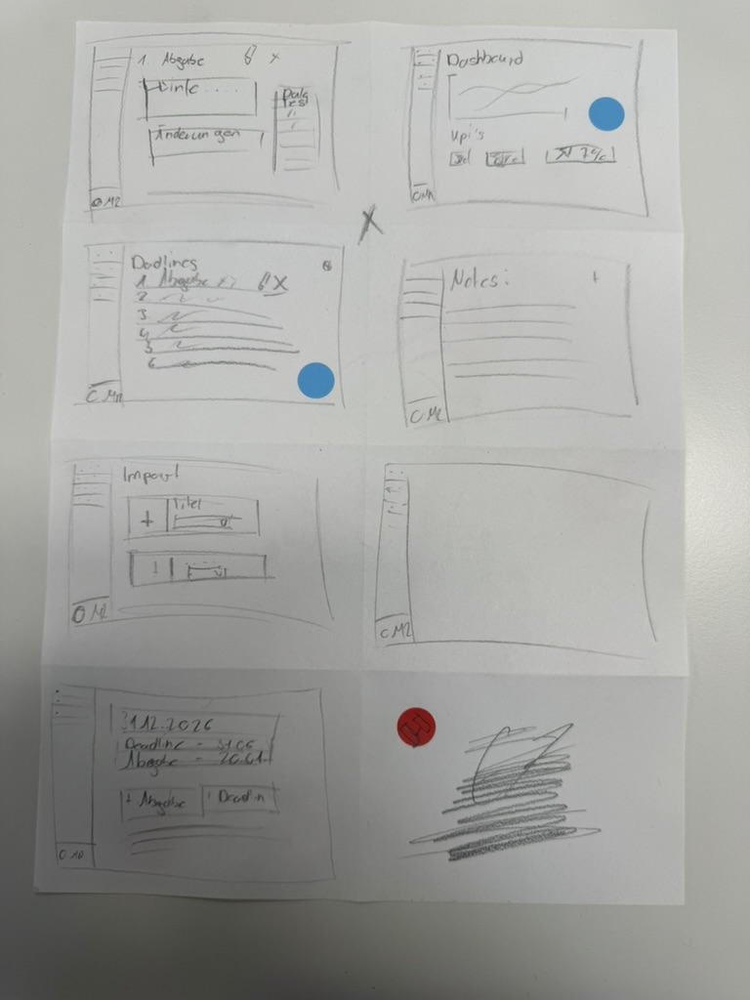
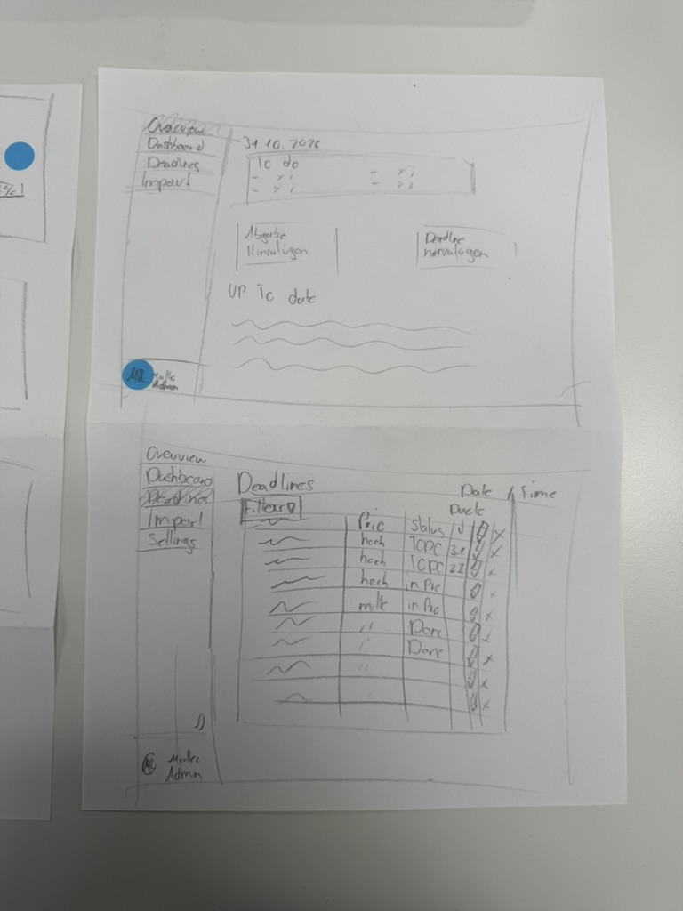

Übung 9 – Skizzieren

StudyDesk · Matteo Rotzer · Prototyping HS26

# 1 Proto-Personas

StudyDesk bündelt Module, Leistungsnachweise/Deadlines und Lernzeit an einem Ort – statt verteilt auf Moodle, Mail, Teams und PDFs. Die zwei Proto-Personas unterscheiden sich bewusst: **Julian** hat ein System, aber zu wenig Zeit; **Leonie** hat Zeit, aber noch kein System.

J

<b>Julian, 23</b> «der Effiziente mit Nebenjob»

Wirtschaftsinformatik, 3. Sem. · Werkstudent 30–40 % · Technik 5/5

> «Ich habe keine Zeit, Fristen an drei verschiedenen Orten abzugleichen.»

| | |
|---|---|
| **Umfeld** | 3–4 Tage Vorlesung, 1,5 Tage Job, lernt in strikt geplanten Blöcken |
| **Ziele** | Keine Deadline verpassen · intensive Wochen früh erkennen · Job und Studium ohne Burnout |
| **Aufgaben** | Termine aus Moodle/PDF/Mail abgleichen und in den Kalender übertragen, Lernblöcke planen |
| **Frustpunkte** | Widersprüchliche Daten (Moodle vs. PDF) · alles 3–4-fach nachführen · keine Schnittstellen |

L

<b>Leonie, 20</b> «die Erstsemestrige im Kanal-Dschungel»

Betriebsökonomie, 1. Sem. · kein Job · Technik 3/5

> «Ich habe ständig Angst, auf Teams oder Moodle eine wichtige Deadline zu übersehen.»

| | |
|---|---|
| **Umfeld** | 4–5 Tage Vorlesung, viele Module, noch kein fester Lernrhythmus |
| **Ziele** | Orientierung finden · ein System, das funktioniert · erstes Semester ohne verpassten Leistungsnachweis |
| **Aufgaben** | Infos aus Teams, Outlook, Moodle und PDFs zusammensuchen, Abgaben notieren |
| **Frustpunkte** | Zu viele Kanäle · jeder Moodle-Kurs anders aufgebaut · Unsicherheit, etwas übersehen zu haben |

**Unsicherheiten / weitere Nutzerforschung:** Die Personas beruhen auf eigener Erfahrung und Gesprächen mit Mitstudierenden. Offen ist, (a) ob Studierende bereit sind, Deadlines **manuell** zu erfassen, (b) wie wichtig die **Lernzeit-Planung** im Vergleich zur reinen Deadline-Übersicht ist und (c) ob Leonie ohne Erklärung zurechtkommt. Das prüfe ich im Usability-Test (Phase Validate).

# 2 Crazy 8s

**Gewähltes Feature/Flow:** «Leistungsnachweise und Deadlines im Griff behalten». Gezeichnet in 8 Minuten, von Hand.

{width=58%}

| Feld | Idee | Dots |
|---|---|:-:|
| 1 | **Abgaben-Page** – Abgabe erfassen/bearbeiten, Änderungen, Seitenliste der Abgaben | |
| 2 | **Dashboard** – Verlaufsdiagramm und KPI-Kacheln (z. B. Fortschritt in %) |  |
| 3 | **Deadlines-Liste** – nummerierte Liste mit Bearbeiten/Löschen pro Eintrag |  |
| 4 | **Notes** – einfache Notizliste pro Modul | |
| 5 | **Import** – Einträge aus dem Semesterprogramm übernehmen (Titel + Datum) | |
| 6 | leer (Zeit abgelaufen) | |
| 7 | **Tagesansicht** – Datum mit fälligen Einträgen, Buttons «+ Abgabe» / «+ Deadline» | |
| 8 | verworfene Idee, durchgestrichen |  |

Feldnummern: links/rechts, von oben nach unten. Alle Felder nutzen die seitliche Navigationsleiste.

# 3 Feedback aus dem Peer-Voting

Gruppe: Aakash, Oliver, Jelmer. Dots: je ein blauer Punkt auf **Dashboard** (Feld 2) und **Deadlines-Liste** (Feld 3), ein roter Punkt auf dem verworfenen Feld 8.

| Von | Das gefällt mir, weil … | Ich würde ergänzen / kritisch … |
|---|---|---|
| **Alle** | Das **Dashboard** und die **seitliche Navigationsleiste** – man findet sich schnell zurecht; dazu die kleinen, netten Features. | Die Crazy 8s sind **nicht schön gezeichnet** und dadurch teilweise schwer lesbar. |
| **Oliver** | Die **Import-Funktion**: bewusst simpel gehalten und user-friendly. | – |
| **Jelmer** | Die **Abgaben-Page**: Einträge lassen sich **auf einen Schlag ändern**, und die Darstellung ist übersichtlich. | – |
| **Aakash** | (siehe «Alle») | Manche Screens wirken **zu voll** – das könnte Nutzer:innen **verwirren**. |

# 4 Reflexion zum Entscheidungsprozess

**Welche Idee habe ich ausgewählt?**
Eine **Kombination aus Overview/Dashboard (Feld 2 und 7) und der Deadlines-Liste (Feld 3)**, eingebettet in die **seitliche Navigationsleiste**. Die Overview beantwortet auf einen Blick «Was steht an?» und bietet die Schnellaktionen «Abgabe hinzufügen» und «Deadline hinzufügen». Die Deadlines-Liste habe ich zu einer Tabelle mit Priorität, Status und Datum weiterentwickelt.

**Warum genau diese?**
Beide Ideen treffen den Kern meiner Personas: Leonie fragt «Was ist jetzt dran?», Julian braucht eine verlässliche, zentrale Übersicht, in der er schnell erfassen kann. Ohne diese zwei Screens hätte StudyDesk keinen Mehrwert gegenüber Moodle.

**Wie hat das Feedback meine Entscheidung beeinflusst?**
Dass **alle** das Dashboard und die seitliche Navigation mochten und die Dots auf Dashboard und Deadlines lagen, hat meinen Fokus bestätigt – ich habe genau diese Elemente ausgearbeitet. **Aakashs Kritik**, dass manches zu voll wirkt, hat mich dazu gebracht, die ausgearbeitete Skizze bewusst schlank zu halten: nur der Happy Path, auf der Overview nur das Nächste, Import und Settings nur als Menüpunkte. Die von **Oliver** gelobte Import-Funktion behalte ich als einfache Ergänzung für später (Should), weil sie Julian viel Zeit spart – aber erst, wenn der Kern steht.

**Selbstkritik und was ich mitnehme**

- **Zeichnen ist nicht meine Stärke** – die Kritik an der Darstellung kann ich gut nachvollziehen. Bei Crazy 8s zählt zwar die Idee, nicht die Schönheit, aber unleserliche Skizzen erschweren das Feedback. Für die Projekt-Skizzen arbeite ich deshalb sauberer (iPad, Raster, klare Beschriftung).
- **Weniger ist mehr:** Aakashs Hinweis deckt sich mit meinen Personas – vor allem Leonie darf nicht überfordert werden. Jeder Screen soll eine Hauptaufgabe haben.
- **8 Varianten statt 8 Screens:** Ich habe eher 8 verschiedene Screens gezeichnet statt 8 Varianten desselben Features. Für den wichtigsten Screen (Overview) hätte ich mehr Alternativen gebraucht – das hole ich nach.
- **Crazy 8s als Startpunkt:** In 8 Minuten waren alle meine Gedanken zur App auf Papier, und ich habe gesehen, welche Screens wirklich zentral sind.
- **Nächster Schritt:** Die Crazy 8s und diese Skizze verstehe ich als **erste Ideen**. Darauf aufbauend zeichne ich die massgeblichen Projekt-Skizzen neu auf dem iPad (mehrere Varianten für Overview und Deadlines), wähle eine Variante aus und setze sie danach als Mockup in Figma um.

# 5 Ausgearbeitete Skizze (Happy Path)

Von Hand, ohne Visual Design – nur Grundkonzept, Interaktionen und die wichtigsten Elemente.

{width=52%}

**Navigation (beide Screens):** Seitennavigation mit Overview, Dashboard, Deadlines, Import, Settings; unten der angemeldete User (Avatar «MR»).

| Screen | Wichtigste Elemente | Interaktion |
|---|---|---|
| **Overview** (Startseite) | Heutiges Datum, Box «To do» mit den nächsten Aufgaben, Bereich «Up to date» (letzte Änderungen) | Buttons «Abgabe hinzufügen» und «Deadline hinzufügen» öffnen direkt das Erfassen |
| **Deadlines** | Tabelle mit Titel, Priorität (hoch/mittel), Status (To do / In Progress / Done), Fälligkeitsdatum | Filter oben links; pro Zeile Bearbeiten (Stift) und Löschen (×) |

KI-Deklaration: Texte zu Reflexion, Skizzenbeschreibung und User Journey Map wurden mit Claude (Anthropic) formuliert und von mir geprüft und angepasst. Ideen, Skizzen, Personas und Entscheide stammen von mir. Details: docs/ai-log.md im Repo.

# 6 User Journey Map (SOLL)

**Persona:** Leonie · **Szenario:** Eine Dozentin kündigt in der Vorlesung eine Abgabe an. Leonie will sie sofort festhalten, priorisieren und später als erledigt abhaken – ohne Angst, etwas zu vergessen. *(Happy Flow)*

| | **1 · Starten & Überblick** | **2 · Deadline erfassen** | **3 · Prüfen & priorisieren** | **4 · Erledigen & Fortschritt** |
|---|---|---|---|---|
| **Ziel** | Sofort sehen, was ansteht | Abgabe in < 30 s festhalten | Wissen, was zuerst kommt | Abschluss festhalten, Fortschritt sehen |
| **Aktionen** | App öffnen → Login → Overview mit «To do» und nächsten Deadlines | «Deadline hinzufügen» → Titel, Modul, Datum, Priorität → Speichern | Deadlines öffnen → nach Datum sortiert → Filter Modul/Status → Priorität anpassen | Status auf «Done» → Eintrag verschwindet aus «To do» → Fortschritt im Dashboard steigt |
| **Touchpoints** | Login, Overview | Formular, Erfolgsmeldung | Deadlines-Tabelle, Filter | Deadlines-Tabelle, Dashboard |
| **Emotion¹** | Orientierung – «ich habe den Überblick» | «Das ging schnell» | Kontrolle, Sicherheit | Erleichterung, Motivation |
| **Risiko²** | Beim ersten Start ist die Overview leer → Verunsicherung; zu viele Infos auf einmal | Pflichtfeld vergessen, Datum falsch eingegeben, Modul fehlt | Tabelle wird bei vielen Einträgen unübersichtlich; Überfälliges geht unter | Eintrag versehentlich erledigt oder gelöscht |
| **Mitigation³** | Leerzustand mit Hinweis «Erste Deadline hinzufügen»; nur die nächsten 5 Einträge | Validierung mit klarer Fehlermeldung, Datumsauswahl, Modul-Dropdown, Erfolgsmeldung | Standard-Sortierung nach Fälligkeit, farbige Badges für Priorität/Status, Überfälliges rot | Status jederzeit änderbar; Bestätigung vor dem Löschen |

¹ Emotion, die wir auslösen wollen · ² mögliche Probleme · ³ wie wir die Risiken minimieren

