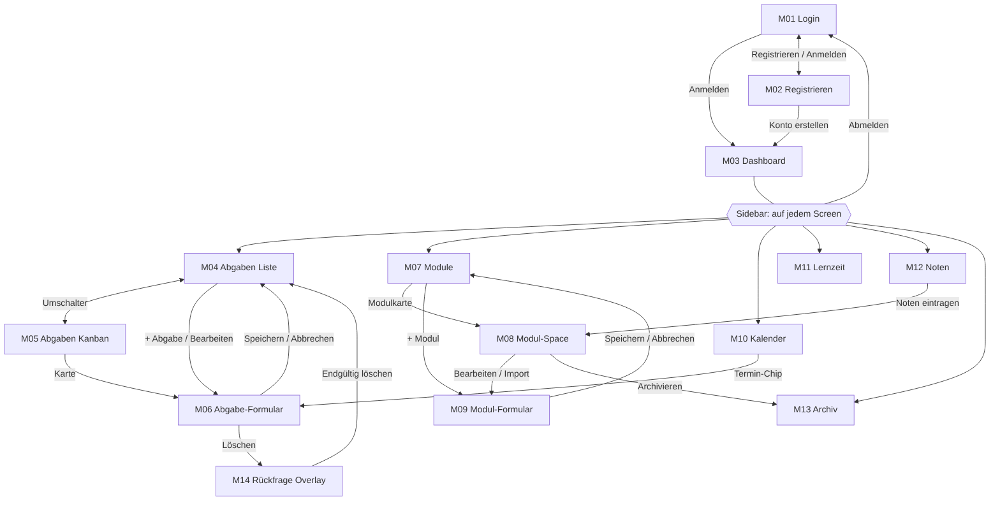
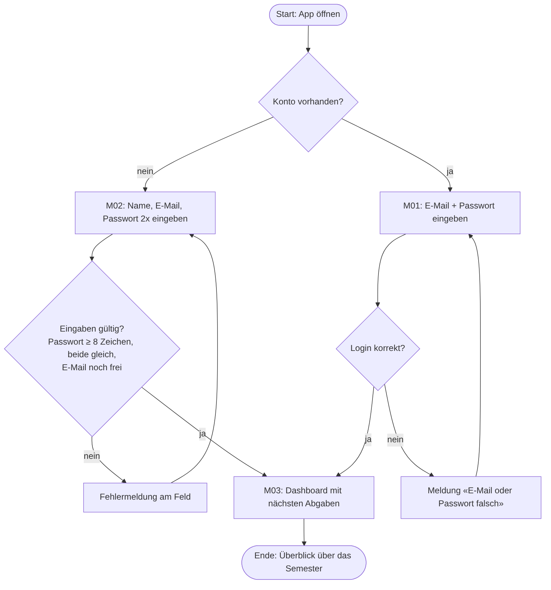
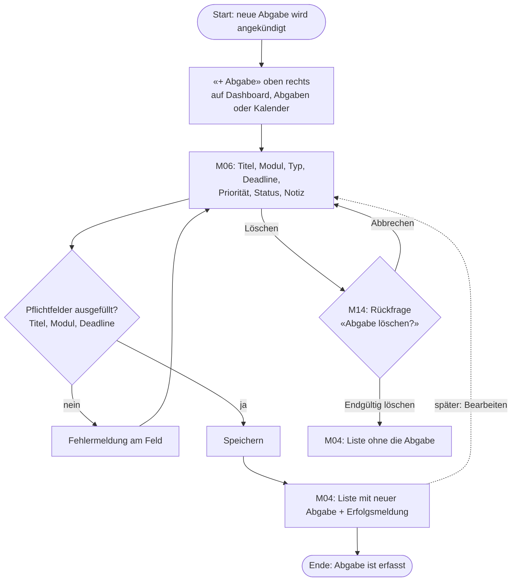
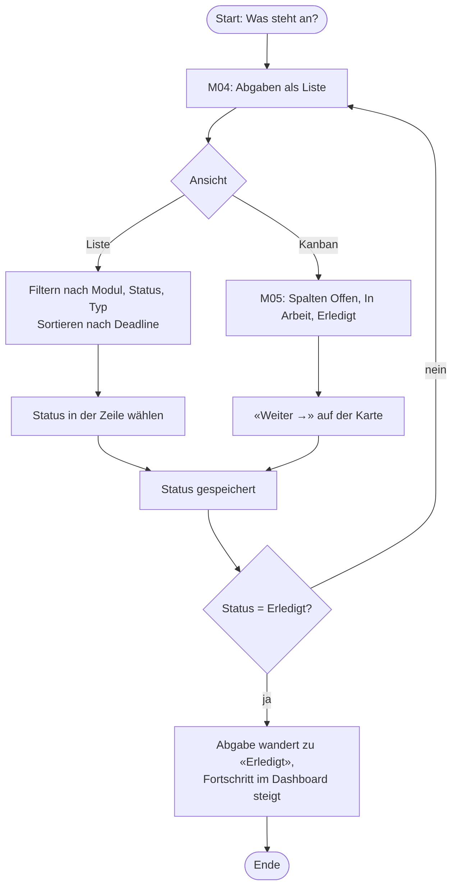
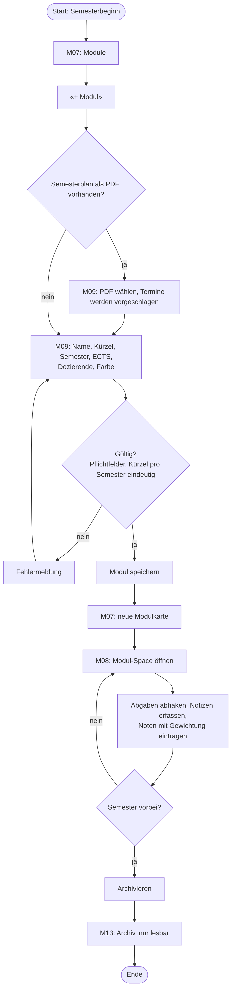

Übung 10 – UI Prototyping / Mockup

StudyDesk · Matteo Rotzer · Prototyping HS26 · 24.11.2026

# 1 Link zum Prototyp

| | |
|---|---|
| **Klickbarer Prototyp** | <https://www.figma.com/proto/XofFCUkretdp9KRkDgiZRn/StudyDesk?page-id=1%3A3&node-id=11-332&starting-point-node-id=11%3A332&scaling=scale-down> |
| **Figma-Datei (Design)** | <https://www.figma.com/design/XofFCUkretdp9KRkDgiZRn> – Seite «2 Mockup» (Seite «1 Wireframes» = Vorstufe mit beiden Varianten) |
| **Tool** | Figma (Design + Prototype-Modus) |
| **Start** | Screen «M01 Login» → Button «Anmelden» |

**Bedienung:** Der Prototyp startet beim Login. Die Sidebar ist auf jedem Screen verlinkt. Klickbare Stellen zeigt Figma mit einem blauen Rahmen, wenn man neben ein Element klickt.

**StudyDesk in einem Satz:** Eine Webapp, in der Studierende Module, Abgaben/Deadlines, Lernzeit und Noten an einem Ort verwalten, statt verteilt auf Moodle, Mail, Teams und PDFs.

# 2 Ausgangslage und Vorgehen

1. **Recherche** (Übung 8): Problem, zwei Proto-Personas (Julian mit Nebenjob, Leonie im ersten Semester), 35 User Stories mit MoSCoW.
2. **Skizzen** (Übung 9 und danach): Crazy 8s als erste Ideen, dann 11 eigene iPad-Skizzen.
3. **Wireframes**: Skizzen in Figma als Graustufen-Wireframes nachgebaut (14 Screens), mit zwei Navigations-Varianten (Sidebar/Topbar) und zwei Abgaben-Ansichten (Liste/Kanban).
4. **Entscheid**: Varianten verglichen und gewählt (Kapitel 3).
5. **Mockup**: Grundlayout (Sidebar + Inhaltsbereich) und Komponenten (Button, Eingabefeld, Navigationspunkt, Modul-Badge), danach 14 Pages und 4 Overlays, zuletzt die Verlinkung im Prototype-Modus.
6. **Durchspielen** der Workflows und Korrekturen (Kapitel 5).

## Screens im Mockup

| Nr. | Screen | Zweck |
|--|-----|--------|
| M01 / M02 | Login / Registrieren | Zugang, gleiches Formular-Muster, Karte zentriert vor Naturbild |
| M03 | Dashboard | «Was ist als Nächstes fällig?», Kennzahlen, Module |
| M04 / M05 | Abgaben als Liste / Kanban | alle Abgaben, Umschalter oben rechts |
| M06 | Abgabe erfassen & bearbeiten | Formular als Modal über der Liste |
| M07 | Module | Modulkarten pro Semester |
| M08 | Modul-Space | Abgaben, Notizen und Noten eines Moduls |
| M09 | Modul erfassen & bearbeiten | Formular als Modal, inkl. PDF-Import |
| M10 | Kalender | Monatsansicht der Abgaben, .ics-Abo |
| M11 | Lernzeit | Timer und Statistik pro Modul |
| M12 | Noten | Schnitt und Notenpunkte über alle Semester |
| M13 | Archiv | abgeschlossene Semester, nur lesbar |
| M14 | Rückfrage «Abgabe löschen?» | Overlay vor dem endgültigen Löschen |
| M15 | Noten einstellen | Overlay im Modul-Space: Leistungsnachweise (LN, MEP) hinzufügen, gewichten, löschen; Wunschnote wählen, nötige Note wird berechnet |
| M16 | Einstellungen | Profil, Darstellung, Hinweise, Kalender, Konto |
| M17 | Widgets anpassen | Overlay: Dashboard-Widgets ein- und ausblenden |
| M18 | Kalender abonnieren | Overlay: .ics-Link kopieren, Anleitung für Apple und Google Kalender |

# 3 Designentscheide

| # | Thema | Entscheid | Begründung |
|-|-----|------|-------------|
| 1 | **Art der Navigation** | **Sidebar links** (statt Topbar) | StudyDesk hat 7 Hauptbereiche plus Einstellungen. In der Topbar wird das eng, sobald noch Aktionen dazukommen. Die Sidebar ist auf jedem Screen gleich, zeigt den aktiven Bereich und lässt sich später erweitern. Nachteil: etwas weniger Breite für Tabellen, auf 1280 px aber unkritisch. |
| 2 | **Desktop vs. Mobile** | **Desktop-first** (1280 × 800) | Beide Personas planen ihr Semester am Laptop, neben Moodle und PDFs. Tabellen, Kanban und Kalender brauchen Breite. Für Mobile ist vorgesehen, dass die Sidebar zu einem Burger-Menü wird und Karten untereinander stehen. Das ist nicht Teil dieses Mockups. |
| 3 | **Abgaben: Liste oder Kanban** | **Beide, mit Umschalter** | Die Liste ist besser zum Suchen, Filtern und Sortieren (Julian: schnell abgleichen). Das Kanban zeigt den Stand auf einen Blick (Leonie: was ist offen, was läuft). Beide zeigen dieselben Daten, darum ist der Mehraufwand klein. |
| 4 | **Formulare** | **Modal über der Seite**, ein Formular für Erfassen und Bearbeiten | Der Kontext (Liste) bleibt sichtbar, man verliert die Position nicht. Ein einziges Formular-Muster ist einfacher zu lernen und zu bauen. Pflichtfelder sind mit * markiert, Fehler stehen direkt beim Feld. |
| 5 | **Schnellaktionen** | «+ Abgabe» und «+ Modul» immer **oben rechts** | Eine Abgabe erfassen ist die häufigste Aktion und soll von überall in einem Klick erreichbar sein (Ziel: unter 30 Sekunden). |
| 6 | **Statuswechsel im Kanban** | Button **«Weiter →»** statt Drag & Drop | Einfacher umzusetzen, auch mit Tastatur bedienbar und auf Touch zuverlässig. Drag & Drop wäre eine spätere Erweiterung. |
| 7 | **Kalender** | Nur lesen, **.ics-Abo** statt Sync in beide Richtungen | Ein Abo für Apple/Google Kalender deckt den Nutzen ab (Deadlines im eigenen Kalender sehen). Ein echter Sync wäre für das Projekt zu gross. |
| 8 | **Import** | Im **Modul** statt als eigener Menüpunkt | Ein Semesterplan gehört immer zu einem Modul. So ist klar, wohin die importierten Termine kommen. |
| 9 | **Löschen** | Rot abgesetzt, mit **Rückfrage** (Overlay) | Löschen ist endgültig. Die Rückfrage verhindert Fehlklicks, «Speichern» bleibt die einzige Primär-Aktion. |
| 10 | **Farben** | Eine Akzentfarbe (Waldgrün, passend zum Naturbild im Login) für Sidebar, Primär-Aktionen und Links, **eine Farbe pro Modul**, Rot nur für Überfälliges und Löschen | Wenige Farben mit fester Bedeutung. Die Modulfarbe erscheint in Badges, Karten und Kalender gleich, damit man ein Modul überall wiedererkennt. |
| 11 | **Noten im Modul** | Verwaltung der Leistungsnachweise und **Wunschnote** in einem Overlay | Jedes Modul hat andere Leistungsnachweise und Gewichte. Mit der Wunschnote sieht man sofort, welche Note in den offenen Teilen noch nötig ist. Das motiviert mehr als ein fester Wert für die 4.0. |
| 12 | **Dashboard als Startseite** | Kennzahlen oben, darunter «Nächste 5 Abgaben» | Beantwortet die Kernfrage beider Personas sofort nach dem Login. Überfälliges und hohe Belastung (≥ 3 Abgaben pro Woche) sind rot hervorgehoben. |

**Bewusst weggelassen:** «Pinned»-Shortcuts in der Sidebar, Verbindung mit anderen Apps, Drag & Drop, Mobile-Screens. Die App darf später vom Mockup abweichen. Zuerst umgesetzt werden Login, Abgaben und Module (Must).

# 4 Workflows

## 4.1 Übersicht: Screen-Flow des Prototyps

## 4.2 Registrieren und Anmelden

## 4.3 Abgabe erfassen, bearbeiten, löschen

## 4.4 Überblick gewinnen und Status ändern

## 4.5 Modul anlegen, nutzen, archivieren

# 5 Workflows durchgespielt

| Workflow | Pfad im Prototyp | Ergebnis |
|----|--------|-----|
| Anmelden | M01 «Anmelden» → M03 | durchspielbar |
| Registrieren | M01 «Registrieren» → M02 «Konto erstellen» → M03 | durchspielbar |
| Abgabe erfassen | M03 «+ Abgabe» → M06 «Speichern» → M04 | durchspielbar |
| Abgabe bearbeiten | M04 «Bearbeiten» → M06 «Speichern» → M04 | durchspielbar |
| Abgabe löschen | M06 «Löschen» → M14 «Endgültig löschen» → M04 | durchspielbar, «Abbrechen» schliesst das Overlay |
| Ansicht wechseln | M04 Umschalter → M05 → Umschalter → M04 | durchspielbar |
| Modul anlegen | M07 «+ Modul» → M09 «Modul speichern» → M07 | durchspielbar |
| Modul nutzen | M07 Karte «Prototyping» → M08 → «←» → M07 | durchspielbar |
| Modul archivieren | M08 «Archivieren» → M13 | durchspielbar |
| Noten | M12 «Noten eintragen →» → M08 | durchspielbar |
| Noten einstellen | M08 «Einstellen» → M15 → «Speichern» | durchspielbar, Overlay schliesst wieder |
| Einstellungen | Sidebar «Einstellungen» → M16 → «Widgets anpassen» → M17 | durchspielbar |
| Kalender abonnieren | M10 «.ics abonnieren» → M18 → «Fertig» | durchspielbar |
| Widgets | M03 «Widgets anpassen» → M17 → «Speichern» | durchspielbar |
| Abmelden | Sidebar «Abmelden» → M01 | durchspielbar |

**Anpassungen nach dem Durchspielen**

- Im Kanban war zuerst die ganze Spalte «Offen» klickbar. Jetzt öffnet nur noch der Titel der Karte das Formular.
- Der Navigationspunkt «Module» und die Buttons «Modul speichern» und «Semesterplan importieren» waren nicht verlinkt und wurden ergänzt.
- Rückfrage vor dem Löschen als eigenes Overlay ergänzt (fehlte in den Wireframes als Screen).
- Noten im Modul-Space: statt des festen Hinweises «Für eine 4.0 brauchst du …» gibt es ein Overlay «Noten einstellen». Dort lassen sich Leistungsnachweise verwalten und eine Wunschnote wählen, die nötige Note wird darunter berechnet.
- «Einstellungen», «Widgets anpassen» und «.ics abonnieren» führten zuerst nirgends hin. Dafür gibt es jetzt den Screen M16 und die Overlays M17 und M18.
- Tabellenspalten auf einheitliche Breiten ausgerichtet; Login und Registrieren mit zentrierter Karte.

**Bekannte Grenzen des Mockups**

- Eingaben, Filter, Suche und Timer sind statisch (Beispieldaten). Fehler- und Erfolgsmeldungen sind als Zustand gezeichnet, aber nicht ausgelöst.
- Statuswechsel («Weiter →», Dropdown in der Liste) verändert die Karten nicht.
- Nur das Modul «Prototyping» hat einen Modul-Space, die anderen Modulkarten führen zur Modulübersicht.

KI-Deklaration: Ideen, iPad-Skizzen, Variantenwahl und Designentscheide stammen von mir. Die Umsetzung in Figma (Wireframes, Mockup, Verlinkung) sowie die Formulierung dieses Dokuments und die Flowcharts entstanden mit Unterstützung von Claude (Anthropic) über die Figma-Schnittstelle und wurden von mir geprüft. Figma Make wurde nicht verwendet.

